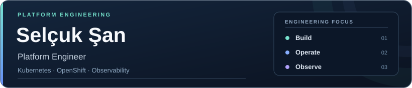
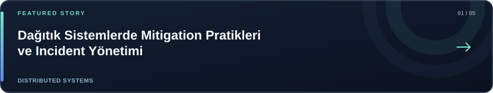
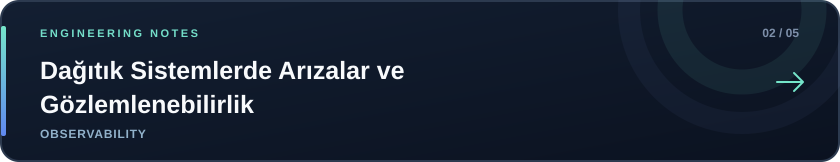
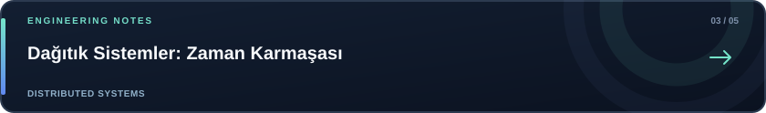
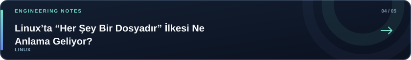
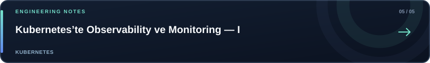

 

&nbsp;

&nbsp;

### About

I work in **platform engineering**, with a focus on Kubernetes and OpenShift environments. I explore the engineering practices behind reliable infrastructure, monitoring, and distributed systems—and document what I learn through technical articles.

### Focus areas

| Platform & infrastructure | Monitoring & reliability | Engineering topics |
| :--- | :--- | :--- |
| Kubernetes · OpenShift · Linux | Prometheus · Grafana · Observability | Distributed systems · Incident management |

## Latest articles

Platform Engineering · Kubernetes · Observability · Distributed Systems

<!-- medium-posts:start -->

  

  

  

  

  

<a href="https://medium.com/@selcuk.san">Read all articles on Medium ↗</a>

<!-- medium-posts:end -->
